# 🐀 Pigeon & Rat

**A jaywalking food heist on a New York street — made in Unreal Engine 5.8 with AI across the whole pipeline.**

You are a New York rat. Today's menu is on the far sidewalk: pizza, a hot dog, soda and strawberry cheesecake. Hop across eight lanes of taxis, buses and bikes, grab the food, and carry it back to your nest — while a pigeon dive-bombs you to steal it.

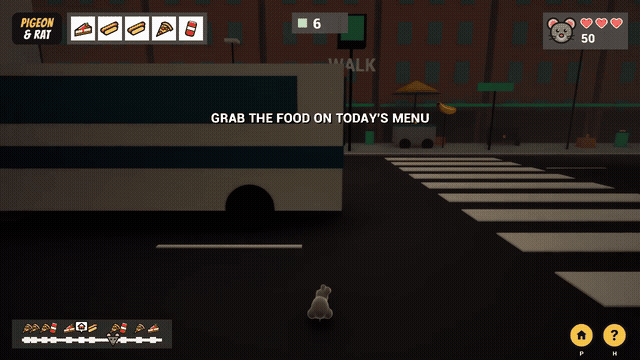

| | |
|---|---|
| **Download (Windows)** | [**Latest release → PigeonAndRat_Windows.zip**](https://github.com/yche1364-YJ/game-Pigeon-and-Rat-UE/releases/latest) |
| **Gameplay demo (30 s)** | [Docs/PigeonRat_Demo_30s.mp4](Docs/PigeonRat_Demo_30s.mp4) |
| **Engine** | Unreal Engine 5.8 (Blueprint-only project) |
| **Course** | AME 294 · Portfolio Game 3 |
| **AI tools** | Claude (coding agent via Unreal MCP) · Tripo AI (3D) · ElevenLabs (audio) |

---

## Contents
1. [How to play](#1-how-to-play)
2. [Game overview: Reward · Damage · End](#2-game-overview-reward--damage--end)
3. [Screens and UI](#3-screens-and-ui)
4. [In-game scenes](#4-in-game-scenes)
5. [How the idea grew (Human × AI)](#5-how-the-idea-grew-human--ai)
6. [Tripo 3D asset pipeline](#6-tripo-3d-asset-pipeline)
7. [Audio](#7-audio)
8. [Project structure and building from source](#8-project-structure-and-building-from-source)
9. [Credits and attribution](#9-credits-and-attribution)

Other documents: **[PROMPT_LOG.md](PROMPT_LOG.md)** (full AI prompt log, error recovery, reflection) · **[ATTRIBUTION.md](ATTRIBUTION.md)** (asset licenses and AI tools inventory)

---

## 1. How to play

**Install:** download `PigeonAndRat_Windows.zip` from [Releases](https://github.com/yche1364-YJ/game-Pigeon-and-Rat-UE/releases/latest), unzip the whole folder, and double-click **`PigeonAndRat.exe`**. If Windows SmartScreen warns, choose *More info → Run anyway*. You need Windows 10/11 (64-bit) and a DirectX 12 GPU.

| Key | Action |
|---|---|
| **↑ ↓ ← →** | Hop one tile. The keys are relative to the camera, so ↑ always means "forward". |
| **↑ at the hot dog cart** | Climb onto the cart to grab the hot dog |
| **P / Esc** | Pause (Resume / Menu / Exit) |
| **H** | How to play |
| **Enter** | Confirm on menus |
| **Mouse** | Click the buttons; the 🏠 and ❓ buttons are in the bottom-right corner |

**Goal:** deliver the **5 foods on today's menu** (top-left) to your nest before you run out of **3 lives**.

1. Look at the menu (top-left) and the strip map (bottom-left). Each food icon on the map shows where that food is along the street.
2. Hop across the road. Touch a food on the far sidewalk to grab it. The hot dog is on top of the cart, so press ↑ to climb up.
3. The camera turns around. Follow the yellow arrow back home. The 🏠 icon on the map marks the nest.
4. Watch the sky. When **PIGEON!** flashes, a pigeon is swooping in to steal what you carry.
5. Crossing on a red light (**JAYWALK**) is risky but builds a combo for bonus points.

---

## 2. Game overview: Reward · Damage · End

| Pillar | What it is in the game |
|---|---|
| **Reward** | **Food:** +100 per delivery, +150 for pizza or cheesecake. **Forward progress:** +10 for each new row. **Jaywalk combo:** crossing on red pays +20 × combo. **Lives bonus:** +100 per heart left on a win. The best score is saved to disk (NEW BEST). The menu card ticks each delivered food ✔. |
| **Damage** | **Taxis, buses and bikes:** −1 heart. **Pedestrians** can step on you: −1 heart. **The pigeon thief** steals the food you carry, so you must go back for it. **The city gets busier:** after every crossing there are more cars, more pedestrians and faster traffic. The first crossing is deliberately slow and gentle. |
| **End** | **Win:** deliver all 5 foods → **STREET CLEAR!** screen, then the *Next Block* / Donate comic page. DONATE opens [chenyingju.com/contact-form](https://chenyingju.com/contact-form). **Lose:** 0 hearts → **GAME OVER** screen with stats. Both screens have *Try again / Menu*, so you never need to restart the game. |

**More systems:**
- Food respawns 3–6 s after you take it.
- Food sits in different places: on the ground, on cardboard boxes, on green trash cans, on benches, and on top of the hot dog cart.
- There are three crosswalks. A traffic signal drives the jaywalk logic, and cars yield to pedestrians.
- The camera flips 180° when you carry food, and the controls flip with it.
- Pause and How-to-Play overlays.

---

## 3. Screens and UI

All UI art was designed together with Claude first as web mock-ups (comic-book halftone style), then rendered to textures and drawn by a Blueprint HUD. The HUD is laid out in 1280×720 design space and letter-boxed to any resolution.

| Start | Game Over |
|---|---|
| 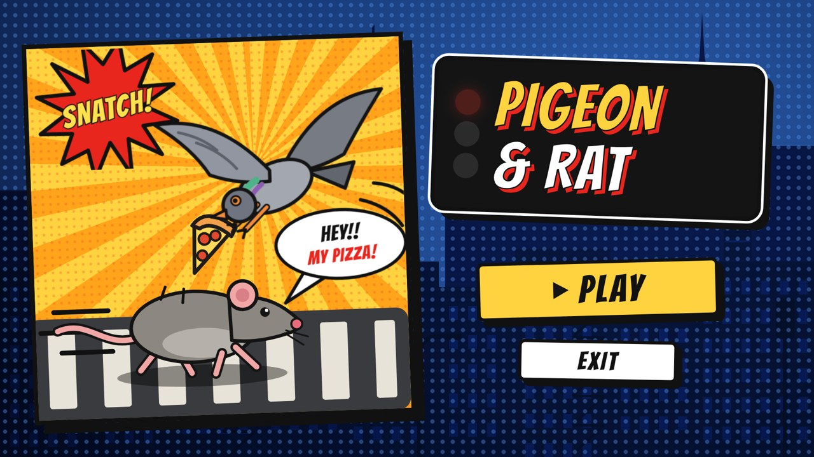 | 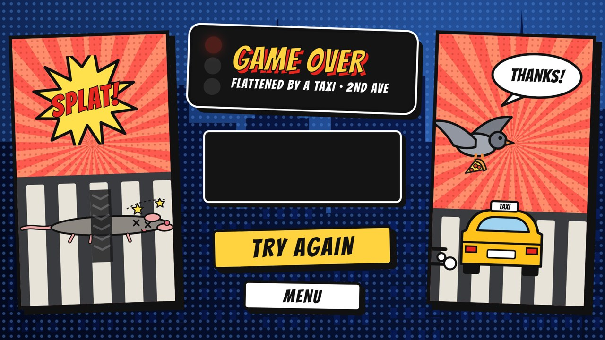 |
| **Street Clear (win)** | **Donate more · Play more** |
| 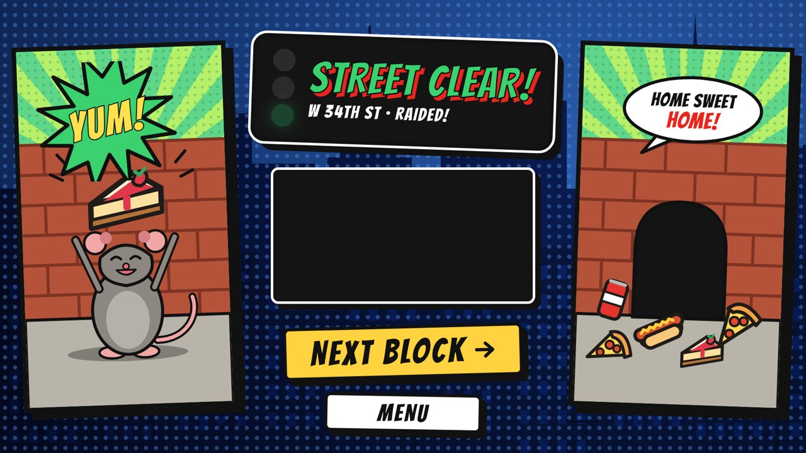 | 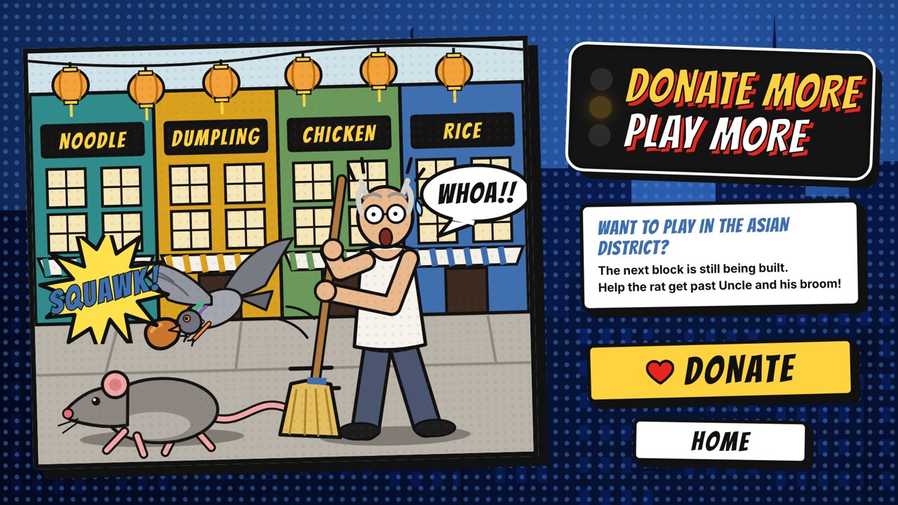 |

The dark panels on the Game Over and Street Clear screens are filled at runtime with score, best combo, food points and lives.

**HUD and How to Play**

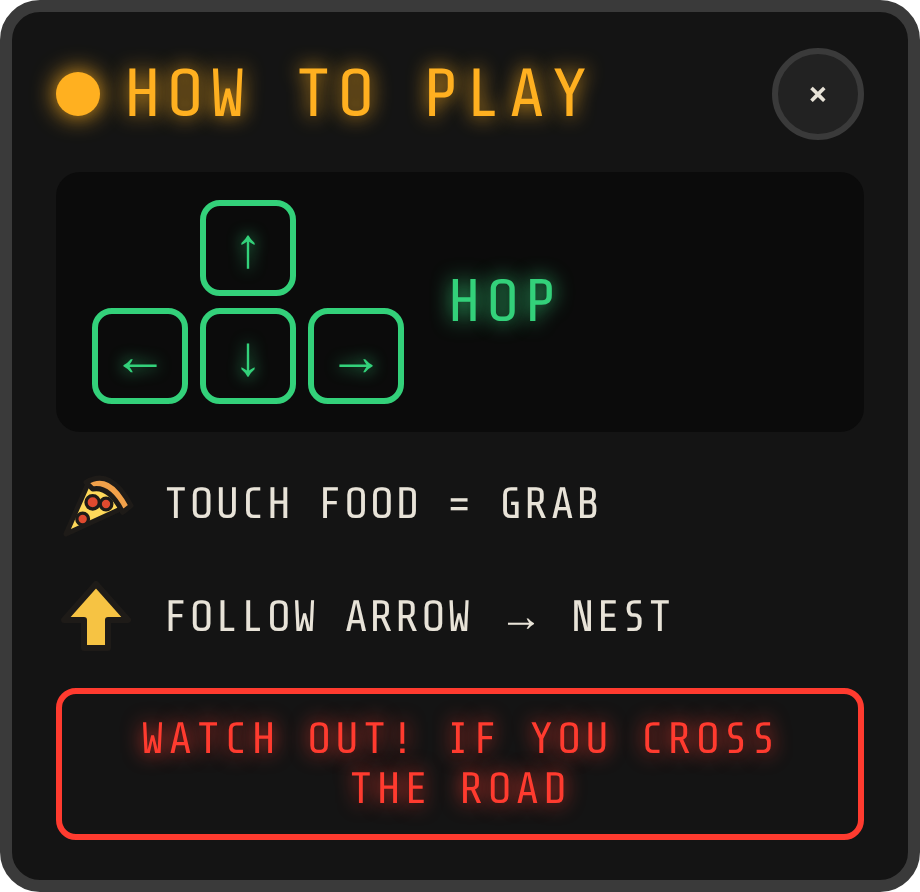

- **Top-left:** PIGEON & RAT title, then today's 5-food menu. Collected foods turn pale with a ✔.
- **Top-center:** traffic-signal state and the current row.
- **Top-right:** rat head, ♥♥♥ lives and the score.
- **Bottom-left:** a squashed strip map. A rat-head triangle marks your position, food icons sit above the dots, and a white 🏠 speech bubble marks the nest.
- **Bottom-right:** 🏠 (pause/menu) and ❓ (help).
- **How to Play:** a black "traffic-light" panel with arrow keys. *Touch food = grab*, *follow arrow → nest*, *WATCH OUT! IF YOU CROSS THE ROAD*.

<br clear="right">

---

## 4. In-game scenes

| | |
|---|---|
| 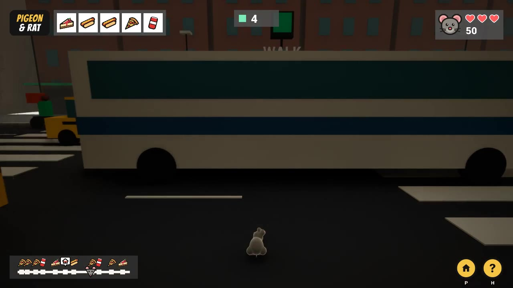 | 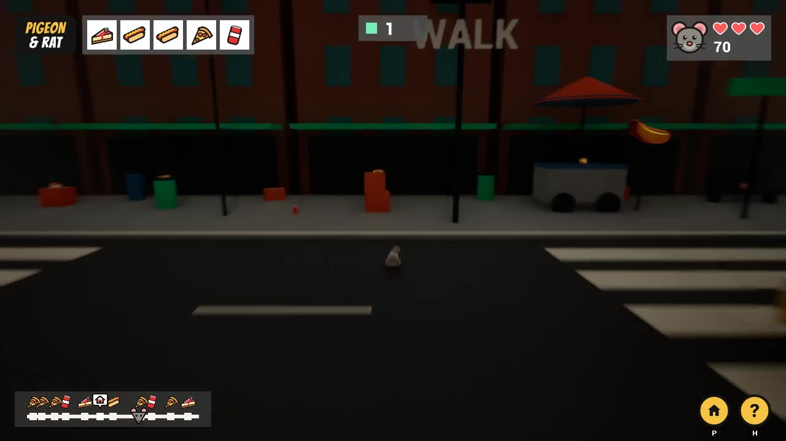 |
| A bus fills the lane, so wait for the gap. | The far sidewalk: hot dog cart, trash cans, boxes and food. |
| 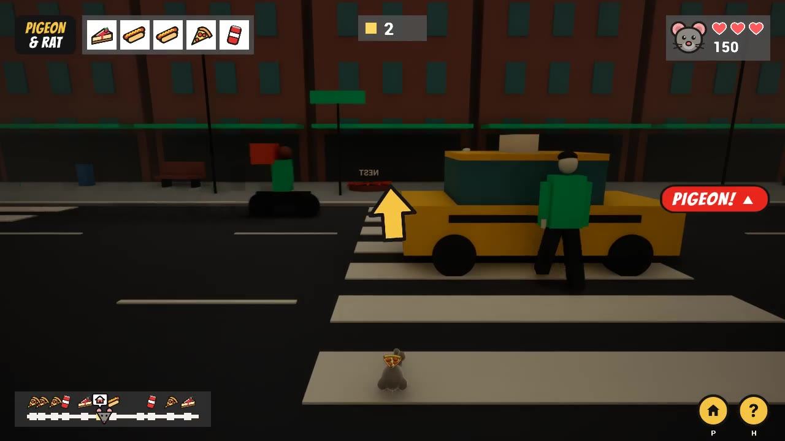 | 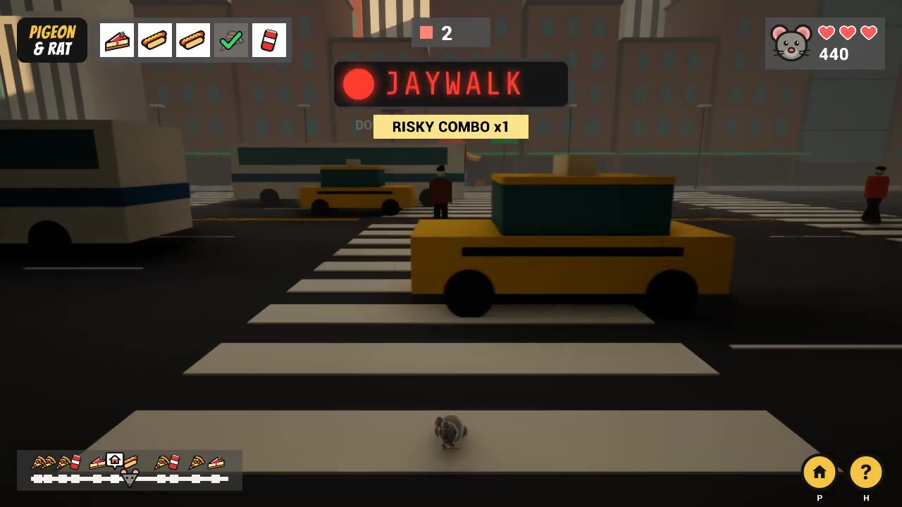 |
| Carrying food home. The arrow points to the nest and the PIGEON! warning flashes. | A JAYWALK combo pays +40. |

Level overview: three crosswalks, the hot dog stand and scattered props.

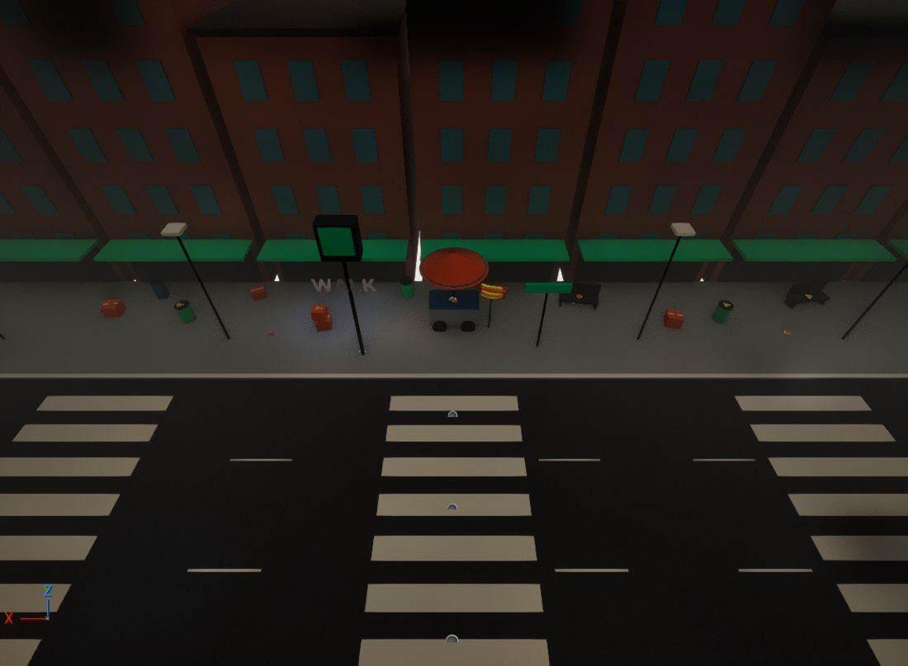

---

## 5. How the idea grew (Human × AI)

This game was built in one long conversation between me (the designer) and **Claude**, an AI coding agent. Claude connected to my Unreal Editor through the **Unreal MCP** toolsets and to my files through the desktop bridge. Below is a short summary of how we worked. The full chronological log is in [PROMPT_LOG.md](PROMPT_LOG.md).

| Phase | What I asked for / decided | What the AI did |
|---|---|---|
| **0. Prototype** | "J-walk" idea: a Crossy-Road-style NYC street, but you *jaywalk* | Built a grey-box level (`JWalkDemo`): lanes, traffic spawners, signal, pedestrians |
| **1. HUD design** | Title top-left and a rat head with lives top-right. The minimap went through **6 iterations**: arrow → circle with nest icon → horizontal strip → black translucent bar → foods above the dots → the rat head itself as the triangle marker. Collected food gets a ✔ and turns pale. | Built HTML mock-ups on a design canvas and redrew each version as I gave feedback |
| **2. Screens** | "Make it look like an American comic." Start: a rat crossing while a pigeon snatches its pizza, a NYC street printed into the blue background, and big Play / Exit buttons. Lose and win screens are symmetrical, with art on both sides and the title in the middle. | Generated the comic layouts. When I asked "is *Street Clear! Next Area* clear?", Claude suggested the **STREET CLEAR! / NEXT BLOCK →** wording to sell the "we raided this block" feeling. |
| **3. Donate page** | After clearing: a *Donate more, play more* comic set in an Asian district. An uncle with a broom looks shocked, a pigeon also grabs food, and the shop signs read Noodle / Dumpling / Chicken / Rice. No Chinese text, not too red. | Drew it and wired the DONATE button and HOME |
| **4. 3D assets** | Generate the rat, pigeon and 4 foods in **Tripo**. I asked which format (FBX), which variant and which texture size. Cheese became **cheesecake**. | Advised on formats; processed the FBX files in Blender (decimate, scale, pivot, colour grade); built one toon master material |
| **5. Into Unreal** | "Build everything we designed in Unreal." | Wrote all the Blueprints through MCP: rat player, pigeon thief AI, food benches, HUD, save game, menus, pause |
| **6. Playtest fixes** | "After crossing I can't turn back without getting hit." The hot dog sign should be a real hot dog on a pole, and I want to climb the cart. | Camera flips 180° when carrying, with relative controls; hot dog sign; cart climbing |
| **7. Difficulty** | "Too hard. Add traffic only after each crossing." Later: "the first crossing should be easier" and "3 lives". | Traffic factor per crossing, +cars, +pedestrians, a 0.5× first crossing; confirmed 3 lives |
| **8. Liveliness** | "Food is placed too regularly, and so are the benches. Put food on boxes, the ground and trash cans. Add crosswalks on the left and right." | Wrote a level-layout script: 9 scattered pickups, crates and trash cans, 2 extra crosswalks, irregular benches |
| **9. Audio** | Use my ElevenLabs music and SFX, plus a squeak on every hop | Imported, looped the ambience, wired the SFX into the Blueprints |
| **10. Ship** | 30 s demo video, packaged build, GitHub, README, presentation | Autopilot capture script, UAT packaging, docs |

**Who did what.** The design decisions, taste calls and playtesting were mine: what the rat should feel like, which screen looked right, when it was too hard. The AI turned each request into engine work: Blueprint graphs, materials, level layout scripts, packaging. It also explained the trade-offs whenever I asked "which is better?"

---

## 6. Tripo 3D asset pipeline

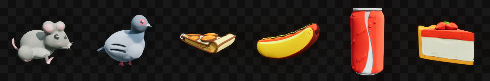

| Asset | Role in game | Tripo input (route: tripo3d.ai **Image-to-3D**, 45 credits each) | In engine |
|---|---|---|---|
| **Rat** | Player character | reference image → `cartoon+mouse+3d+model` | `Assets3D/Rat/SM_Rat_cm`, on `BP_NYC_Rat` |
| **Pigeon** | Enemy (food thief AI) | reference image → `bird+cartoon+3d+model` | `Assets3D/Pigeon/SM_Pigeon_cm`, on `BP_NYC_PigeonThief` |
| **Pizza slice** | Reward pickup (+150) | reference image → `pizza+slice+3d+model` | `Assets3D/Pizza/SM_Pizza_cm` |
| **Hot dog** | Reward pickup + cart sign | reference image → `hot+dog+3d+model` | `Assets3D/HotDog/SM_HotDog_cm` |
| **Soda can** | Reward pickup | reference image → `red+soda+can+3d+model` | `Assets3D/Soda/SM_Soda_cm` |
| **Strawberry cheesecake** | Reward pickup (+150) | reference image → `strawberry+cheesecake+3d+model` | `Assets3D/Cheesecake/SM_Cheesecake_cm` |

No text prompts were used: each model was made with Tripo's Image-to-3D from one uploaded image, 6 × 45 = **270 credits** in total.

**Format pipeline:** Tripo FBX export with PBR textures → **Blender 4 (bpy script, [Tools/blender/proc.py](Tools/blender/proc.py))**:
1. Join meshes and apply transforms.
2. Decimate to about 12k triangles. The raw meshes were too dense, and Unreal reported "all polygons degenerate".
3. Subdivide the rat and pigeon for smooth silhouettes.
4. Scale ×100 to centimetres and put the pivot at the bottom centre.
5. Lay the pizza flat using PCA.

Then **[grade.py](Tools/blender/grade.py)** colour-grades the base-colour textures toward one shared palette, because the 6 Tripo models came out in slightly different styles. The FBX goes into Unreal as `SM_<Name>_cm`, with material instances of a shared `M_ToonMaster`: base texture, tint, Fresnel rim light, normal map, roughness 0.72.

All 6 assets are visible and working in the shipped build: the player, the enemy, and the pickups the player collects.

---

## 7. Audio

| Sound | Source | Where it plays |
|---|---|---|
| NYC street ambience (looping music bed) | **ElevenLabs**, prompt: *"New York street background sounds, NYC jazz vibe"* | `BGM_StreetAmbience` actor; loops through menus and gameplay |
| Lose sting | **ElevenLabs** (same NYC-jazz direction) | `FinishRound` when the state becomes Game Over |
| Win sting | **ElevenLabs** (same NYC-jazz direction) | `FinishRound` when the state becomes Street Clear |
| Rat squeak | Synthesised in Python/numpy by Claude (0.13 s chirp) | `TryHop`, every hop, with a random pitch of 0.92–1.12 |

The ElevenLabs MP3s were converted to WAV in the workspace. The ambience was given a seamless loop by crossfading its tail into its head. All files are in `Content/NYCrossing/Audio/`.

---

## 8. Project structure and building from source

```
MyProject.uproject           UE 5.8, Blueprint-only
Config/                      Default map = L_NYCrossing, Shipping packaging settings
Content/NYCrossing/
  Maps/L_NYCrossing          the game level
  Blueprints/                BP_NYC_Rat (player), BP_NYC_Pigeon (player base logic),
                             BP_NYC_PigeonThief (enemy), BP_NYC_PizzaBench (pickups),
                             BP_NYC_LaneSpawner, BP_NYC_Taxi/Bus/Bike, BP_NYC_Pedestrian,
                             BP_NYC_Signal, BP_NYC_HotDogStand, BP_NYC_Nest,
                             BP_NYC_HUD, BP_NYC_GameMode, BP_NYC_Save
  Assets3D/<Name>/           Tripo assets (mesh, material instance, textures)
  Audio/                     ambience, win, lose, squeak
  UI/                        HUD and screen textures
  Materials/  Buildings/
Content/JWalkDemo/           grey-box prototype materials still used by the level
Tools/                       Blender, UI-generator and level-layout scripts used by the AI
Docs/                        media and the demo video
```

**To open:** install UE 5.8, clone the repo, and double-click `MyProject.uproject`.

**To package:**
1. Go to *Platforms → Windows → Package Project*. The project is already set to Shipping and to cook only `L_NYCrossing`.
2. Or use the UAT command in [PROMPT_LOG.md § Packaging](PROMPT_LOG.md#packaging).

---

## 9. Credits and attribution

- **Design, direction, playtesting:** [@yche1364-YJ](https://github.com/yche1364-YJ) (repository owner)
- **AI coding agent:** Claude (Anthropic), working inside Unreal Editor 5.8 through the Unreal MCP toolsets
- **3D models:** generated with **[Tripo AI](https://www.tripo3d.ai/)**. Models made on Tripo's free plan are public on Tripo; see [ATTRIBUTION.md](ATTRIBUTION.md).
- **Music and SFX:** generated with **[ElevenLabs](https://elevenlabs.io/)**
- **Fonts in UI art:** Bangers, Share Tech Mono, Inter (SIL Open Font License, Google Fonts)
- **Tools:** Unreal Engine 5.8 (Epic Games EULA), Blender (GPL), Python, ffmpeg

Full licence table: **[ATTRIBUTION.md](ATTRIBUTION.md)**.
